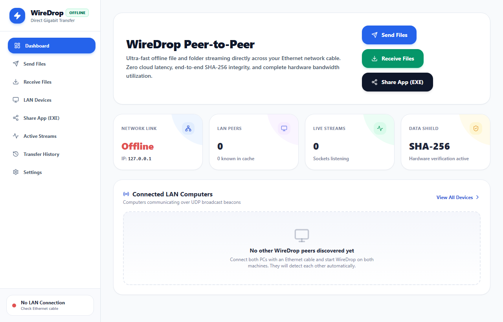
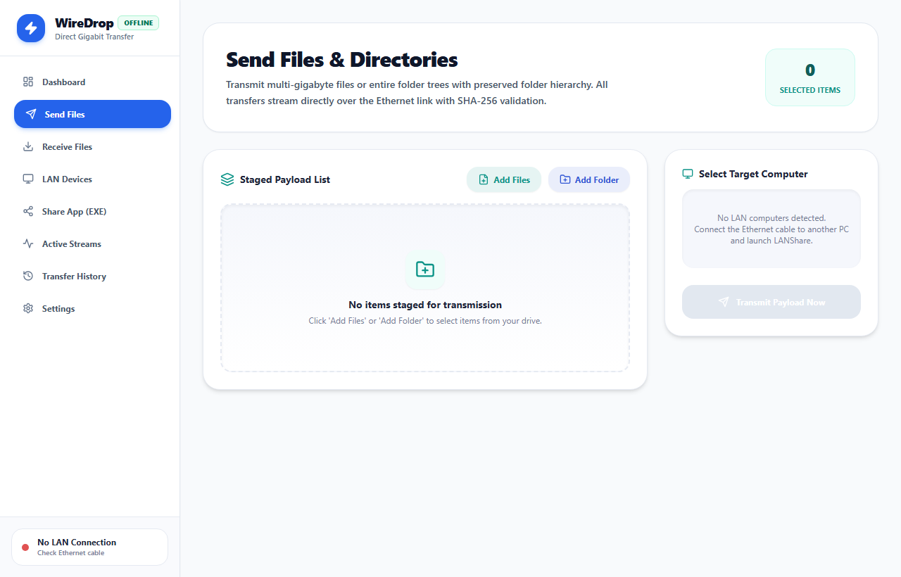
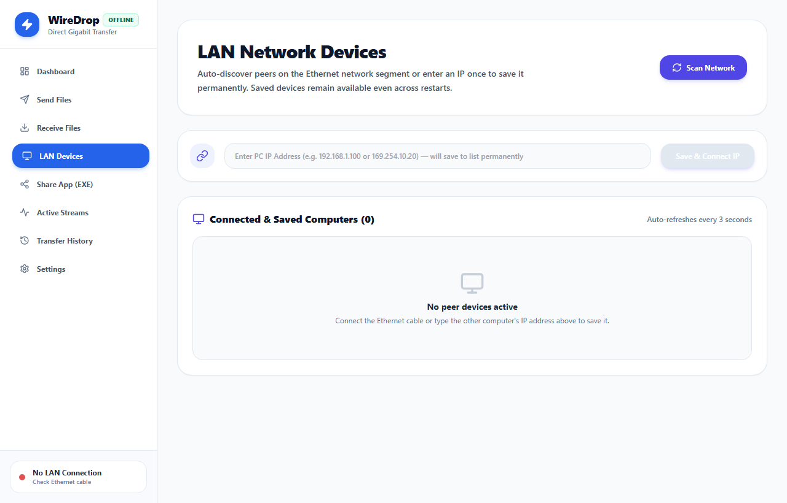
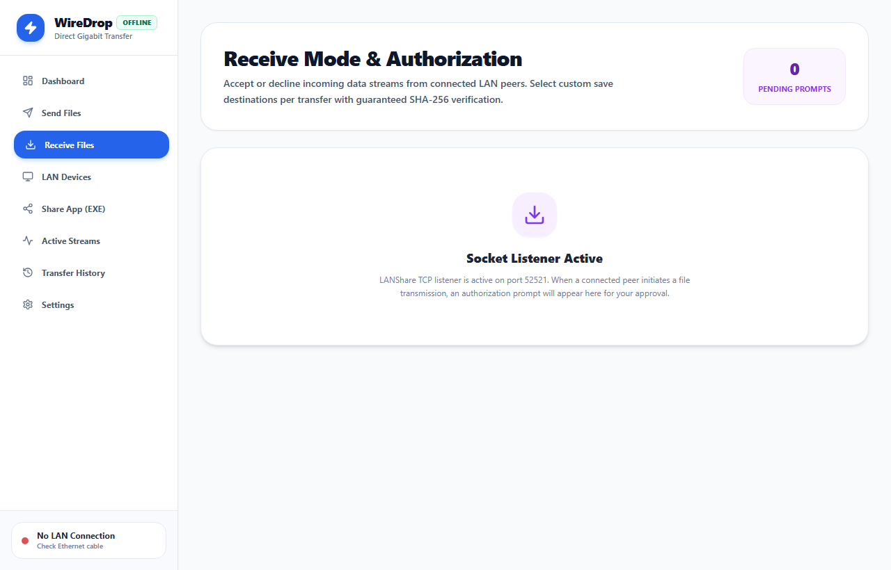
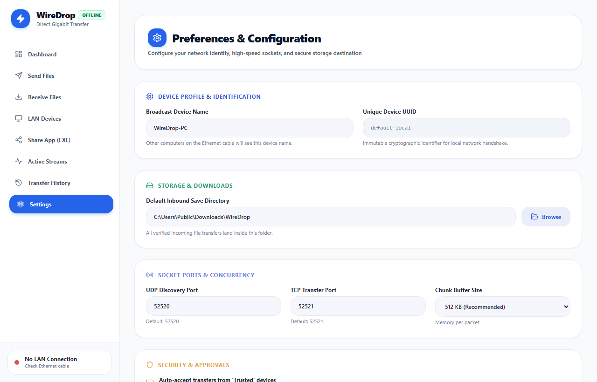

<div align="center">

# ⚡ WireDrop

### Professional Offline LAN & Ethernet File Transfer Desktop Application

[](https://github.com/qu-ddous/File-Trasfer-Desktop-application-useing-Lan-Ethernet-Cable-)
[](https://github.com/qu-ddous/File-Trasfer-Desktop-application-useing-Lan-Ethernet-Cable-)
[-success.svg?style=for-the-badge&logo=speedtest)](https://github.com/qu-ddous/File-Trasfer-Desktop-application-useing-Lan-Ethernet-Cable-)
[](https://github.com/qu-ddous/File-Trasfer-Desktop-application-useing-Lan-Ethernet-Cable-)
[](LICENSE)

<br/>

**AirDrop for Windows over Ethernet Cable.**  
Stream multi-gigabyte files, deep directory trees, and payloads directly between computers at full hardware wire speed — with zero internet connection, zero cloud latency, and cryptographic SHA-256 integrity guarantee.

<br/>

[📦 Download Installer](#-quick-download--installer) •
[📸 UI Screenshots](#-application-interface--screenshots) •
[✨ Key Features](#-key-features) •
[🔌 Cable Setup Guide](#-step-by-step-ethernet-cable-connection-guide) •
[🛠️ Tech Stack](#️-technology-stack) •
[🌐 Network Blueprint](#-network-blueprint--port-architecture) •
[💻 Developer Setup](#-developer-quick-start)

---

</div>

<br/>

## 📸 Application Interface & Screenshots

WireDrop is engineered with a modern, high-contrast light desktop interface designed for maximum productivity, real-time throughput monitoring, and seamless offline peer management.

### 1. Peer-to-Peer Transfer Dashboard
> Real-time link telemetry, adapter IP address resolution, rapid drag-and-drop staging zone, and live peer status.
<p align="center">
  
</p>

---

### 2. High-Speed File & Folder Transmitter
> Payload staging with folder tree hierarchy preservation, batch item summary, individual file size calculation, and instant transmission trigger.
<p align="center">
  
</p>

---

### 3. LAN & Direct Cable Peer Discovery
> Automatic UDP broadcast discovery of connected computers on the local cable link, plus manual IP pairing with persistent SQLite history (never re-enter an IP again).
<p align="center">
  
</p>

---

### 4. Inbound Receiver Mode & Configuration

| Inbound Listener & Approval | Storage & Network Settings |
| :---: | :---: |
|  |  |
| *Active listening socket on port `52521` with transfer confirmations.* | *Custom download directory selector with live disk space telemetry.* |

<br/>

## 🎯 Why WireDrop?

Transferring massive 10GB–100GB+ files (such as 4K video footage, game files, virtual machine disks, or database backups) between two computers usually requires slow cloud uploads, external hard drives, or complex Windows network share configurations.

**WireDrop eliminates all friction**:
1. Plug an Ethernet cable directly between two PCs.
2. Open **WireDrop** on both machines.
3. Select your files and click **Transmit** — files stream directly at **100 MB/s – 125 MB/s (Full Gigabit Wire Speed)**.

<br/>

---

## ✨ Key Features

| Capability | Description |
| :--- | :--- |
| 🚀 **Full Gigabit Wire Speed** | Direct kernel TCP socket streaming using high-throughput 512 KB chunking and 1 MB socket buffers to saturate link capacity. |
| 🔒 **100% Air-Gapped & Offline** | Never touches the internet or third-party cloud servers. Complete privacy and zero external bandwidth usage. |
| 📡 **UDP Auto-Discovery + Persistent IP** | Auto-detects peers via UDP beacon on port `52520`. Manually entered IPs are permanently saved in local SQLite so you never type them twice. |
| 🛡️ **Cryptographic SHA-256 Integrity** | Calculates streaming hashes in real-time on both sender and receiver to guarantee zero corruption or dropped packets. |
| 📂 **Folder Tree Preservation** | Recursively transmits entire folder hierarchies, preserves relative paths, and accurately handles empty directories. |
| 🛡️ **Path Traversal Protection** | Complete security sanitization on inbound file requests to prevent malicious path traversal exploits. |
| 🖥️ **Pure Crisp Light Desktop UI** | High-contrast, clean desktop UI designed with React, Tailwind CSS, Lucide icons, and Electron. |
| 📦 **1-Click Standalone Installer** | Pre-bundled NSIS installer (`WireDrop Setup 1.0.0.exe`) with bundled Python backend and DLLs — ready to run on any PC. |

<br/>

---

## 📦 Quick Download & Installer

You don't need Python or Node.js to use WireDrop on other computers:

| Distribution | Format | Description |
| :--- | :--- | :--- |
| **[WireDrop Setup 1.0.0.exe](release/WireDrop%20Setup%201.0.0.exe)** | Windows Installer | **Recommended.** Self-contained installer bundling all DLLs, Electron, and Python backend. Installs in 1-click and creates Desktop shortcuts. |
| **[WireDrop-Windows-x64.zip](release/WireDrop-Windows-x64.zip)** | Portable Zip | Portable archive. Extract and run directly without installation. |

> **💡 USB Flash Drive Tip:** Copy just `WireDrop Setup 1.0.0.exe` to a flash drive, plug it into the second computer, and double-click to install!

<br/>

---

## 🔌 Step-by-Step Ethernet Cable Connection Guide

Connecting two computers with an Ethernet LAN cable is instant and straightforward:

```
┌─────────────────────┐       RJ-45 Ethernet Cable       ┌─────────────────────┐
│     Computer A      │ ◄──────────────────────────────► │     Computer B      │
│  IP: 169.254.46.23  │       (Cat5e / Cat6 / Cat7)      │  IP: 169.254.88.10  │
│      (WireDrop)     │                                  │      (WireDrop)     │
└─────────────────────┘                                  └─────────────────────┘
```

### 1. Connect the Cable
Plug any standard RJ-45 Ethernet cable (Cat5e, Cat6, or Cat7) directly into the Ethernet port of both computers.

### 2. Launch WireDrop
Open **WireDrop** on both computers.

### 3. Windows Firewall Prompt *(Important)*
When WireDrop starts for the first time, Windows Defender Firewall will prompt for network permissions:
> ⚠️ **IMPORTANT:** Check **BOTH** checkboxes:
> - ✅ **Private networks**
> - ✅ **Public networks** *(Direct Ethernet cables without a router are categorized as "Public" by Windows. Both must be checked to allow direct peer sockets).*

*Tip: If you missed the prompt, run this command in Administrator PowerShell on both PCs:*
```powershell
netsh advfirewall firewall add rule name="WireDrop" dir=in action=allow protocol=TCP localport=52520-52522; netsh advfirewall firewall add rule name="WireDrop UDP" dir=in action=allow protocol=UDP localport=52520-52522
```

### 4. Connect by IP & Send
1. Look at the **Dashboard** of PC 2 to see its local IP (e.g. `169.254.x.x` or `192.168.x.x`).
2. On PC 1, navigate to **LAN Devices**, type PC 2's IP in the box, and click **Save & Connect IP**.
3. The IP will be saved permanently in your device list and show **Online**.
4. Go to **Send Files**, select your files or folder, pick the target device, and click **Transmit Payload Now**.
5. On PC 2, click **Accept Transfer** when prompted. The files will stream directly at wire speed into `Downloads/WireDrop`!

<br/>

---

## 🌐 Network Blueprint & Port Architecture

WireDrop uses a dedicated local socket architecture designed for high throughput and zero cloud dependency:

| Port | Protocol | Service | Scope | Purpose |
| :---: | :---: | :---: | :---: | :--- |
| **`52520`** | **UDP** | Discovery Beacon | LAN / Unicast | Bi-directional peer auto-discovery & heartbeat ping-pong |
| **`52521`** | **TCP** | Transfer Server | LAN Direct | High-speed binary streaming of files and directory trees |
| **`52522`** | **HTTP / WS** | Control API | Localhost (`127.0.0.1`) | IPC communication between Electron desktop UI and backend |

<br/>

---

## 🛠️ Technology Stack

<div align="center">

| Layer | Technologies |
| :--- | :--- |
| **Desktop Shell** | Electron 29, Electron Preload, Secure Context Isolation, Safe IPC Handlers |
| **Frontend UI** | React 18, TypeScript, Vite, Tailwind CSS, Lucide React, Framer Motion |
| **Backend Engine** | Python 3.11+, FastAPI, Uvicorn, Asynchronous Sockets, SQLite3, Psutil |
| **Packaging** | Electron Builder (NSIS Installer), PyInstaller (Standalone Backend Bundle) |

</div>

<br/>

---

## 💻 Developer Quick Start

To run and build WireDrop from source:

### Prerequisites
- **Node.js** 18+ & **npm**
- **Python** 3.11+

### 1. Clone the Repository
```powershell
git clone https://github.com/qu-ddous/File-Trasfer-Desktop-application-useing-Lan-Ethernet-Cable-.git
cd File-Trasfer-Desktop-application-useing-Lan-Ethernet-Cable-
```

### 2. Backend Setup
```powershell
cd backend
python -m pip install -r requirements.txt
python run.py
```
*The FastAPI control service will be live on `http://127.0.0.1:52522`.*

### 3. Frontend & Desktop Shell
In a new terminal at project root:
```powershell
npm install
npm run build
npm run build:electron
npm run dev
```

To run the complete packaged Electron app in development:
```powershell
npm run electron:dev
```

### 4. Build Standalone Production Installer
To produce the standalone `WireDrop Setup.exe`:
```powershell
# 1. Compile Python backend into standalone binary
python -m PyInstaller --clean --noconfirm --onedir --name run --distpath backend/dist --workpath backend/build --paths backend --collect-all fastapi --collect-all starlette --collect-all uvicorn --collect-all pydantic --collect-all websockets --collect-all anyio backend/run.py

# 2. Copy compiled backend into resources
Copy-Item -Path backend\dist\run\* -Destination backend-dist -Recurse -Force

# 3. Build React UI & package NSIS installer
npm run build
npm run build:electron
npx electron-builder --win nsis
```
The output installer will be generated in `release/WireDrop Setup 1.0.0.exe`.

<br/>

---

## 🛡️ Security & Privacy Architecture

- **Air-Gapped Privacy**: WireDrop never connects to external servers, collects no analytics, and requires no accounts.
- **Strict Localhost Binding**: The internal control API binds strictly to `127.0.0.1` and is never exposed to external LAN interfaces.
- **Directory Traversal Sanitization**: All incoming file paths are sanitized with strict base-path resolution to prevent malicious relative path escaping (`../`).
- **Context Isolation**: Electron runs with `contextIsolation: true`, `nodeIntegration: false`, and sandboxed preload IPC bridges.

<br/>

---

## 📄 License

This project is licensed under the **MIT License** — see the [LICENSE](LICENSE) file for details.

<div align="center">
  <sub>Built with ❤️ for ultra-fast, seamless offline data transfer.</sub>
</div>
